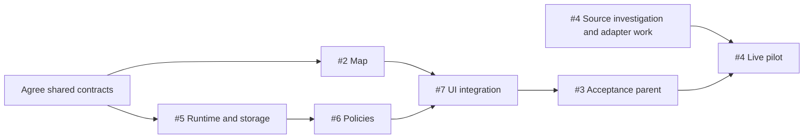

# Implementation plan

This is the execution plan for [parent spec #1](https://github.com/goncalvesjoao/open-akiya/issues/1). Requirements and acceptance tests belong to the linked specs; this document owns coordination, parallel work, and integration gates. The active Electron foundation supplies a map and durable synthetic jobs; this plan does not claim the policy or live-source backlog is complete.

## Implementation worklist

Contract alignment and ticket breakdowns are complete. Start with **#8 (sample map)** and **#13 (durable synthetic import)**; these foundations can proceed independently. If working sequentially, tackle #8, then #13, then select the next ticket whose start conditions are satisfied. Source-shaped fixtures (#33–#35), policy fixtures and mock UI work can proceed against the documented contracts while the runtime finishes.

The groups below are a recommended execution order, not new blocking relationships or a duplicated status tracker. Read each ticket's current start conditions, comments and native dependencies before implementing it; GitHub owns live status. Complete verification within each slice.

### 1. Establish the map and worker foundations

- [#8 — Explore verified sample listings within a selected area](https://github.com/goncalvesjoao/open-akiya/issues/8)
- [#13 — Import and inspect one synthetic listing through a durable local job](https://github.com/goncalvesjoao/open-akiya/issues/13)

#13 now targets Electron launch, the utility-process worker, temporary SQLite test databases and transactional storage. Neither foundation requires a permitted live source.

### 2. Extend the map and local runtime

After #8, its map siblings can proceed independently (the additive address/place-search spec can also build on this foundation):

- [#9 — Explore unverified and approximate listing pins](https://github.com/goncalvesjoao/open-akiya/issues/9)
- [#10 — Explore municipality-only listings through summary pins](https://github.com/goncalvesjoao/open-akiya/issues/10)
- [#11 — Inspect area-associated unknown-location listings](https://github.com/goncalvesjoao/open-akiya/issues/11)
- [#12 — Recover from query and tile failures on desktop and mobile](https://github.com/goncalvesjoao/open-akiya/issues/12)
- [#38 — Search by address or place name to select an area](https://github.com/goncalvesjoao/open-akiya/issues/38)

#38 extends #2 acceptance with user-selected-center lookup and can run independently of backend/live-source work. Its provider and controlled UI/browser checks are required for the expanded #2 scope. Other tickets continue to exclude geocoding within their own scopes; listing geocoding remains excluded everywhere.

After #13, build the runtime capabilities:

- [#14 — Re-import changed offers without duplicates or loss of valid data](https://github.com/goncalvesjoao/open-akiya/issues/14)
- [#15 — Query saved listings with truthful geographic relevance](https://github.com/goncalvesjoao/open-akiya/issues/15)
- [#16 — Finish bounded imports with truthful partial, empty and failed outcomes](https://github.com/goncalvesjoao/open-akiya/issues/16)
- [#17 — Cancel queued and running imports without losing committed results](https://github.com/goncalvesjoao/open-akiya/issues/17)
- [#18 — Recover interrupted imports without replaying committed effects](https://github.com/goncalvesjoao/open-akiya/issues/18)
- [#19 — Retain current-source availability when another source withdraws an offer](https://github.com/goncalvesjoao/open-akiya/issues/19)

#14–#17 can start after #13. #18 requires #16 and #17; #19 requires #14. Verify the runtime through the shared job API seam with temporary SQLite databases and deterministic adapters.

### 3. Implement reuse, refresh and continuation

- [#20 — Reuse fresh covering area imports and recent listing details](https://github.com/goncalvesjoao/open-akiya/issues/20)
- [#21 — Attach requests to covering active work and cancel shared intent safely](https://github.com/goncalvesjoao/open-akiya/issues/21)
- [#22 — Reserve refresh capacity for older known offers](https://github.com/goncalvesjoao/open-akiya/issues/22)
- [#23 — Continue incomplete searches through explicit bounded jobs](https://github.com/goncalvesjoao/open-akiya/issues/23)
- [#24 — Advance discovery checkpoints only from safely completed traversal](https://github.com/goncalvesjoao/open-akiya/issues/24)
- [#25 — Preserve manual-refresh intent through bounded follow-up work](https://github.com/goncalvesjoao/open-akiya/issues/25)
- [#26 — Recover expired cursors with a bounded explained restart](https://github.com/goncalvesjoao/open-akiya/issues/26)

#20–#24 permit contract-backed development now; runtime verification needs the capabilities named in each ticket. #25 requires #21's shared-work ownership; #26 requires #23's continuation path. Prepare their fixtures earlier if useful. Complete #6 only after integration with #5.

### 4. Connect import controls to the map

- [#27 — Import a selected area and discover saved results](https://github.com/goncalvesjoao/open-akiya/issues/27)
- [#28 — Inspect and cancel queued or running imports](https://github.com/goncalvesjoao/open-akiya/issues/28)
- [#29 — Recover import progress after reload or runtime interruption](https://github.com/goncalvesjoao/open-akiya/issues/29)
- [#30 — Request Refresh anyway and track its follow-ups](https://github.com/goncalvesjoao/open-akiya/issues/30)
- [#31 — Continue incomplete searches with truthful outcomes](https://github.com/goncalvesjoao/open-akiya/issues/31)
- [#32 — Explore imported listings through the real local workflow](https://github.com/goncalvesjoao/open-akiya/issues/32)

#27 can start with mocked API responses; its map demo needs #8. #28, #29 and #31 start after #27; #30 starts after #27 and #28. #30 is needed for #31's exhausted-refresh-follow-up scenario, rather than all continuation development. #32 requires the preceding UI slices and completed #2/#6, including the real runtime. Reuse the agreed fixtures rather than creating renderer-only response shapes.

After #5, #6 and #7 pass their integrated acceptance, evaluate aggregate #3. #1 and #3 are acceptance parents, not additional implementation tickets.

### 5. Develop the permitted source and run the gated pilot

- [#33 — Discover Tsubata offers for an intersecting selected area](https://github.com/goncalvesjoao/open-akiya/issues/33)
- [#34 — Normalize and persist Tsubata sale and rental offers](https://github.com/goncalvesjoao/open-akiya/issues/34)
- [#35 — Preserve Tsubata results through failures and explicit continuation](https://github.com/goncalvesjoao/open-akiya/issues/35)
- [#36 — Run and document the small Tsubata live pilot](https://github.com/goncalvesjoao/open-akiya/issues/36)

#33–#35 can start source-shaped fixture development now and overlap the other workstreams. Reuse the shared worker transport, normalization/storage boundary and job API tests as those capabilities become available; routine automated checks make no live-source requests.

The [Tsubata investigation](research/first-live-source.md) identifies the official municipal CSV as a feasible permitted transport. Live activation still requires reviewed geographic reference/reuse evidence, safe offer identities and affirmative residential eligibility. Keep date-based early stopping disabled because this source has no verified per-offer date ordering. Do not use the disallowed catalog API, linked assets or paid discovery.

#36 starts only after #33–#35 and aggregate #3 are complete, with source activation gates resolved. If those checks fail, retain the disabled integration and report the specific blocker. The documented bounded live pilot is required to complete #4; fixtures alone do not satisfy it.

When all acceptance gates for #2, #3 and #4 pass, evaluate parent #1 completion.

## Start conditions and completion gates

| Spec                                                                                        | When work can start                                                                                   | Required to finish                                                                           |
| ------------------------------------------------------------------------------------------- | ----------------------------------------------------------------------------------------------------- | -------------------------------------------------------------------------------------------- |
| [#2 Map and area selection](https://github.com/goncalvesjoao/open-akiya/issues/2)           | Immediately, using synthetic listings                                                                 | Independent map and accessibility checks                                                     |
| [#5 Persistent runtime and storage](https://github.com/goncalvesjoao/open-akiya/issues/5)   | In parallel with #2 once the shared area/listing contracts are agreed                                 | Durable job API, normalized storage, privacy, cancellation, and recovery checks              |
| [#6 Reuse, refresh, and continuation](https://github.com/goncalvesjoao/open-akiya/issues/6) | Once #5's job and adapter contracts settle; fixtures can precede its completed runtime                | Integration with #5 and policy tests                                                         |
| [#7 Map import UI](https://github.com/goncalvesjoao/open-akiya/issues/7)                    | Once map and job contracts settle, using mocked API responses while #2, #5, or #6 finish              | Completed #2 and #6, plus the fixture-backed Electron journey against the real local runtime |
| [#4 First permitted live source](https://github.com/goncalvesjoao/open-akiya/issues/4)      | Source/access investigation immediately; adapter development once source and adapter contracts settle | Completed #3, a permitted enabled source, and a documented live pilot                        |

[#3](https://github.com/goncalvesjoao/open-akiya/issues/3) is the aggregate acceptance parent for #5, #6, and #7, not another implementation task. It closes only after all three children and the integrated fixture-backed journey pass. #1 closes after #2, #3, and #4 pass.

## Parallel work

The shared contracts are aligned. Run the map (#2), backend foundation (#5), and Tsubata fixture development (#4) as separate workstreams. Once job contracts are stable, #6 and #7 can overlap: #6 implements policies while #7 develops the UI against representative responses. Live-adapter fixture work can also overlap when its access method and adapter contract are resolved. The real end-to-end checks and live pilot remain completion gates.

The diagram shows integration/completion dependencies, not a requirement to wait before investigating or building against agreed mocks. In particular, #7 can start before #6 closes, and #4 investigation can start before #3 closes.

## Shared contracts before parallel implementation

Record these contracts in the owning specs and use the same deterministic fixtures across workstreams. The 2026-10-15 alignment is recorded in the existing owning specs below. These are documentation contracts, not implemented endpoints. Consumers expand their shared response recipes into deterministic fixtures rather than inventing separate shapes.

| Contract                                                                                                                 | Owner      | Consumers  |
| ------------------------------------------------------------------------------------------------------------------------ | ---------- | ---------- |
| Selected area: center coordinates, units, validation, 10 km limit                                                        | #2 with #5 | #6, #7, #4 |
| Listing projection: identity, money, availability, coordinate provenance, municipality grouping, source link, timestamps | #5 with #2 | #7, #4     |
| Job API: create/inspect/cancel/results, immutable scope, states, counters, errors, reconnectable identifiers             | #5         | #6, #7     |
| Policy API extensions: freshness, refresh intent, attachment, follow-ups, continuation, coverage and checkpoints         | #6         | #7, #4     |
| Source adapter: discovery/detail/normalization, capabilities, cursors, dates, request accounting                         | #5 with #6 | #4         |

Include examples for running, queued, empty success, partial continuation, expired-cursor restart, pending manual-refresh follow-up, cancellation, and failure. UI mocks must conform to the agreed API and be replaced by the real runtime for acceptance. A contract change updates the owning spec, fixtures, and affected consumers together; do not independently invent competing shapes.

## GitHub dependency conventions

Native blocked-by relationships represent **completion gates**, not a blanket prohibition on investigation or fixture-backed development. Read the start conditions above before claiming parallel work. Parent/sub-issue relationships represent scope ownership; avoid dependencies between a parent and its own children that would create a cycle.

- #5 has no finished-map dependency.
- #6 is blocked by #5 for integrated completion.
- #7 is blocked by #2 and #6 for integrated completion, but mock-backed development may begin once their contracts settle.
- #3 retains #2 as a completion gate and requires all its children by its acceptance contract.
- #4 is blocked by #3 for the live pilot and completion, not for source investigation.

Keep those GitHub relationships synchronized when this plan changes. The specs remain authoritative for behavior; this document is authoritative for start conditions and coordination. Current issue state lives in GitHub rather than a duplicated status table here.

## Integration and release checkpoints

1. Independently release the labeled sample-data map after #2 passes.
2. Verify #5 at the existing job API seam with local temporary SQLite databases and synthetic adapters.
3. Verify #6 policies at that same seam, then connect #7 to the real runtime and run the agreed Electron journey. Close #3 only after integrated acceptance.
4. Run the permitted source's small live pilot after #3 passes, then evaluate #4 and parent #1 completion. No unresolved source permission is treated as a completed live integration.

Do not add duplicate implementation tasks for #1 or #3. Preserve bounded requests, local-only storage, no paid discovery, and the user-confirmed scope throughout parallel work.

## Contract alignment handoff (2026-10-15)

- [#2 selected-area/query contract](specs/map-area-selection.md#shared-selected-area-and-query-contract) and [#5 listing/results/job/adapter contracts](specs/persistent-local-import-runtime.md#shared-contracts-listing-projection-and-area-results) permit map and backend foundation work in parallel.
- [#6 policy examples](specs/import-reuse-and-continuation.md#shared-policy-extensions-and-response-examples) permit policy fixture work and [#7 mock UI development](specs/import-progress-map-ui.md#contract-consumption-and-fixture-handoff) while the runtime finishes. Concrete recipes cover queued/running, empty success, partial/continuation, cursor restart, refresh follow-up, cancellation and failure. Implementations should materialize the same recipes as fixtures; none exist in runtime code yet.
- [#4 source handoff](specs/live-area-source-integration.md#shared-contract-handoff-and-remaining-source-decisions) and the [Tsubata investigation](research/first-live-source.md) support source-shaped fixture development. Live activation retains the geographic-reference, identity and residential-eligibility gates; #36 retains the integrated-flow and access requirements.

No new product choice blocks synthetic parallel work. Technical recommendations are explicit in the owning specs, including a configurable 25% stale-refresh reservation. Readiness here refers to interface documentation; all existing acceptance checks and completion dependencies remain required.
