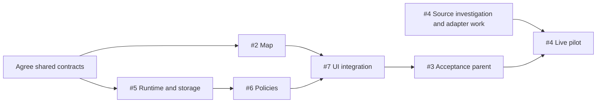

# Implementation plan

This is the execution plan for [parent spec #1](https://github.com/goncalvesjoao/open-akiya/issues/1). Requirements and acceptance tests belong to the linked specs; this document owns coordination, parallel work, and integration gates. The project currently has a landing page and a basic listing schema; this plan does not claim implementation work is complete.

Use the [copy-and-paste session prompts](session-prompts.md) to align contracts, prepare implementation tickets, and investigate the first live source in fresh sessions.

## Start conditions and completion gates

| Spec                                                                                        | When work can start                                                                                   | Required to finish                                                                          |
| ------------------------------------------------------------------------------------------- | ----------------------------------------------------------------------------------------------------- | ------------------------------------------------------------------------------------------- |
| [#2 Map and area selection](https://github.com/goncalvesjoao/open-akiya/issues/2)           | Immediately, using synthetic listings                                                                 | Independent map and accessibility checks                                                    |
| [#5 Persistent runtime and storage](https://github.com/goncalvesjoao/open-akiya/issues/5)   | In parallel with #2 once the shared area/listing contracts are agreed                                 | Durable job API, normalized storage, privacy, cancellation, and recovery checks             |
| [#6 Reuse, refresh, and continuation](https://github.com/goncalvesjoao/open-akiya/issues/6) | Once #5's job and adapter contracts settle; fixtures can precede its completed runtime                | Integration with #5 and policy tests                                                        |
| [#7 Map import UI](https://github.com/goncalvesjoao/open-akiya/issues/7)                    | Once map and job contracts settle, using mocked API responses while #2, #5, or #6 finish              | Completed #2 and #6, plus the fixture-backed browser journey against the real local runtime |
| [#4 First permitted live source](https://github.com/goncalvesjoao/open-akiya/issues/4)      | Source/access investigation immediately; adapter development once source and adapter contracts settle | Completed #3, a permitted enabled source, and a documented live pilot                       |

[#3](https://github.com/goncalvesjoao/open-akiya/issues/3) is the aggregate acceptance parent for #5, #6, and #7, not another implementation task. It closes only after all three children and the integrated fixture-backed journey pass. #1 closes after #2, #3, and #4 pass.

## Parallel work

Start with a short contract-alignment step, then run the map (#2), backend foundation (#5), and source investigation (#4) as separate workstreams. Once job contracts are stable, #6 and #7 can overlap: #6 implements policies while #7 develops the UI against representative responses. Live-adapter fixture work can also overlap when its access method and adapter contract are resolved. The real end-to-end checks and live pilot remain completion gates.

The diagram shows integration/completion dependencies, not a requirement to wait before investigating or building against agreed mocks. In particular, #7 can start before #6 closes, and #4 investigation can start before #3 closes.

## Shared contracts before parallel implementation

Record these contracts in the owning specs and use the same deterministic fixtures across workstreams. The 2026-10-15 alignment is recorded in the existing owning specs below. These are documentation contracts, not implemented endpoints. Consumers expand their shared response recipes into deterministic fixtures rather than inventing separate shapes.

| Contract                                                                                                                 | Owner      | Consumers  |
| ------------------------------------------------------------------------------------------------------------------------ | ---------- | ---------- |
| Selected area: center coordinates, units, validation, 10 km limit                                                        | #2 with #5 | #6, #7, #4 |
| Listing projection: identity, money, availability, coordinate provenance, municipality grouping, source link, timestamps | #5 with #2 | #7, #4     |
| Job API: create/inspect/cancel/results, immutable scope, states, counters, errors, reconnectable identifiers             | #5         | #6, #7     |
| Policy API extensions: freshness, refresh intent, attachment, follow-ups, continuation, coverage and checkpoints         | #6         | #7, #4     |
| Source adapter: discovery/detail/normalization, capabilities, cursors, dates, request accounting                         | #5 with #6 | #4         |

Include examples for running, queued, empty success, partial continuation, expired-cursor restart, pending manual-refresh follow-up, cancellation, and failure. UI mocks must conform to the agreed API and be replaced by the real runtime for acceptance. A contract change updates the owning spec, fixtures, and affected consumers together; do not independently invent competing shapes.

## GitHub dependency conventions

Native blocked-by relationships represent **completion gates**, not a blanket prohibition on investigation or fixture-backed development. Read the start conditions above before claiming parallel work. Parent/sub-issue relationships represent scope ownership; avoid dependencies between a parent and its own children that would create a cycle.

- #5 has no finished-map dependency.
- #6 is blocked by #5 for integrated completion.
- #7 is blocked by #2 and #6 for integrated completion, but mock-backed development may begin once their contracts settle.
- #3 retains #2 as a completion gate and requires all its children by its acceptance contract.
- #4 is blocked by #3 for the live pilot and completion, not for source investigation.

Keep those GitHub relationships synchronized when this plan changes. The specs remain authoritative for behavior; this document is authoritative for start conditions and coordination. Current issue state lives in GitHub rather than a duplicated status table here.

## Integration and release checkpoints

1. Independently release the labeled sample-data map after #2 passes.
2. Verify #5 at the existing job API seam with local test Postgres and synthetic adapters.
3. Verify #6 policies at that same seam, then connect #7 to the real runtime and run the agreed browser journey. Close #3 only after integrated acceptance.
4. Run the permitted source's small live pilot after #3 passes, then evaluate #4 and parent #1 completion. No unresolved source permission is treated as a completed live integration.

Do not add duplicate implementation tasks for #1 or #3. Preserve bounded requests, local-only storage, no paid discovery, and the user-confirmed scope throughout parallel work.

## Contract alignment handoff (2026-10-15)

- [#2 selected-area/query contract](specs/map-area-selection.md#shared-selected-area-and-query-contract) and [#5 listing/results/job/adapter contracts](specs/persistent-local-import-runtime.md#shared-contracts-listing-projection-and-area-results) permit map and backend foundation work in parallel.
- [#6 policy examples](specs/import-reuse-and-continuation.md#shared-policy-extensions-and-response-examples) permit policy fixture work and [#7 mock UI development](specs/import-progress-map-ui.md#contract-consumption-and-fixture-handoff) while the runtime finishes. Concrete recipes cover queued/running, empty success, partial/continuation, cursor restart, refresh follow-up, cancellation and failure. Implementations should materialize the same recipes as fixtures; none exist in runtime code yet.
- [#4 source handoff](specs/live-area-source-integration.md#shared-contract-handoff-and-remaining-source-decisions) retains the unresolved permitted-source and geographic-evidence gates. Investigation can proceed now; enabled live work and its pilot retain their existing requirements.

No new product choice blocks synthetic parallel work. Technical recommendations are explicit in the owning specs, including a configurable 25% stale-refresh reservation. Readiness here refers to interface documentation; all existing acceptance checks and completion dependencies remain required.
